# Proximal Policy Optimization (PPO) — Relatório experimental

**Autores:** Frederico Barbosa Relvas · Henrick de Souza Silva · **Fork com
`algorithms/ppo.py`, `networks/discrete_actor_critic.py` e
`configs/ppo_lunarlander_final.yml`:** https://github.com/FredRelvas/t-zero-learning

LunarLander-v3. O config inicial `configs/ppo_lunarlander.yml` traz os defaults do `ppo.py` do
CleanRL, ajustados para o CartPole. O critério é `eval/mean_return` ≥ 200 **e**
`episodic_return_mean_last100` ≥ 200 nas seeds 1 e 2; o orçamento é de 2M passos. O config final
resolve com **1M**, metade do orçamento. Cada passo da busca está no W&B sob um `exp_name`
próprio (`ppo_lunarlander`, `ppo_ll_m1`, …, `ppo_lunarlander_final`), 2 seeds cada.

## Parte 4 — As mudanças, e o que levou a cada uma

| chave | de | para | o gráfico que motivou |
|---|---|---|---|
| `ppo.num_steps` | 128 | **1024** | `advantage_std` de 0,9 a 26: o lote de 512 cobria ~1 episódio, e cada atualização via uma amostra de comportamento diferente |
| `ppo.num_minibatches` | 4 | **32** | nenhum: acompanha a linha acima para manter o minibatch em 128 |
| `ppo.gamma` | 0,99 | **0,999** | `episodic_length` preso em ~950 com retorno ~0: o agente pairava |
| `ppo.gae_lambda` | 0,95 | **0,98** | nenhum: acompanha o `gamma`, para o horizonte do GAE não ficar curto demais |
| `ppo.learning_rate` | 2,5e-4 | **1e-3** | `approx_kl` ≈ 0,003 e `clipfrac` ≈ 0,005: rollout subaproveitado |
| `ppo.ent_coef` | 0,01 | **0,001** | `entropy` travada em ~1,0 de ln 4 ≈ 1,39 nos runs que não pousavam |

Todo o resto ficou como estava, incluindo `total_timesteps = 1e6`, `num_envs = 4`,
`clip_coef = 0,2`, `update_epochs = 4` e a rede 64×64 Tanh.

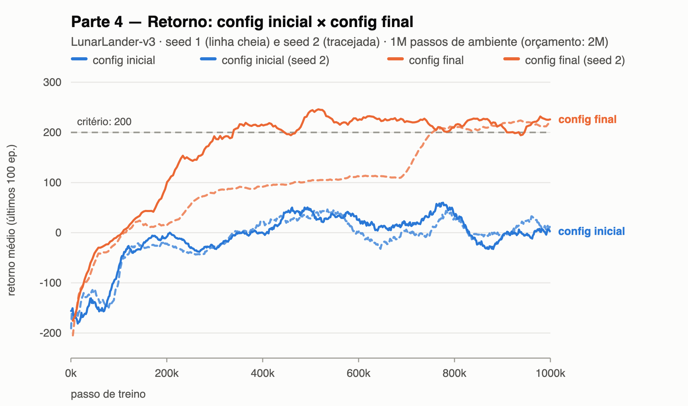 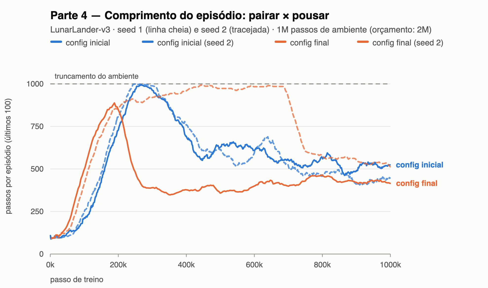 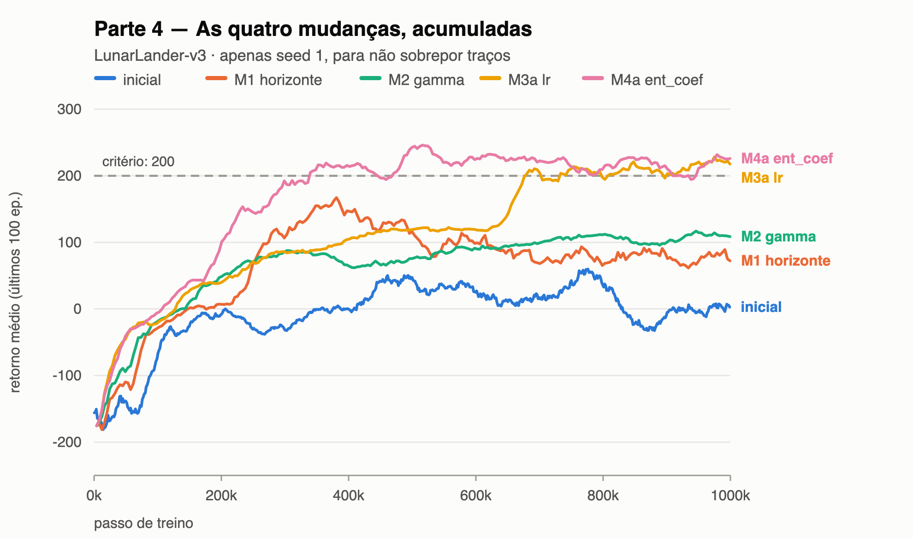

**O diagnóstico inicial.** O primeiro gráfico mostra o config inicial (azul) subindo de −170 até
~+45 em 500k passos e depois **regredindo** para 2,7 e 12,2 nas duas seeds, com avaliação −11 e
+14. O segundo gráfico explica o que ele aprendeu: o comprimento do episódio sobe até bater no
truncamento de 1000 passos e se estabiliza em ~520. Episódio longo com retorno perto de zero é a
assinatura de **pairar** — o agente aprendeu a não cair, e parou aí. Dois números fecham o
diagnóstico: `approx_kl` e `clipfrac` ficaram em 0,000 do começo ao fim, ou seja, as 4 épocas
quase não moviam a política e o clipping nunca ativou; e `grad_norm` chegou a 8–24 contra
`max_grad_norm = 0,5`, com os picos acompanhando os de `value_loss` (374 e 522), não os da policy
loss. O terceiro gráfico antecipa o resultado das quatro mudanças, acumuladas, na seed 1.

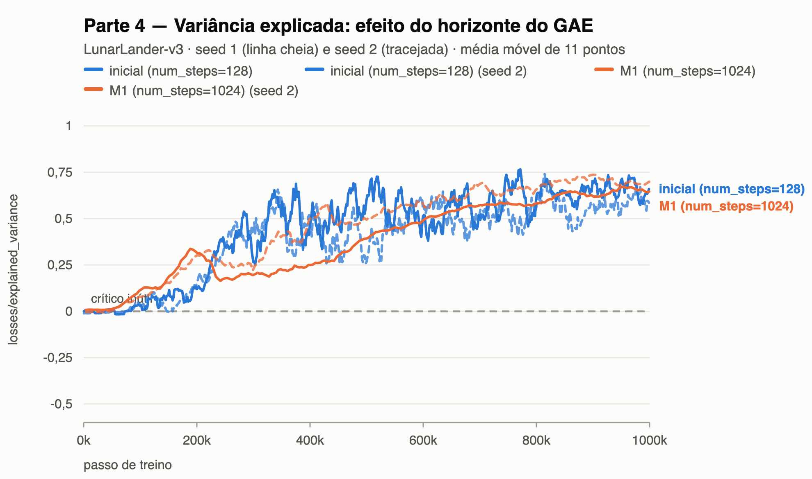 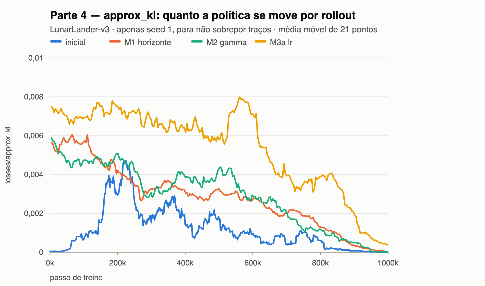 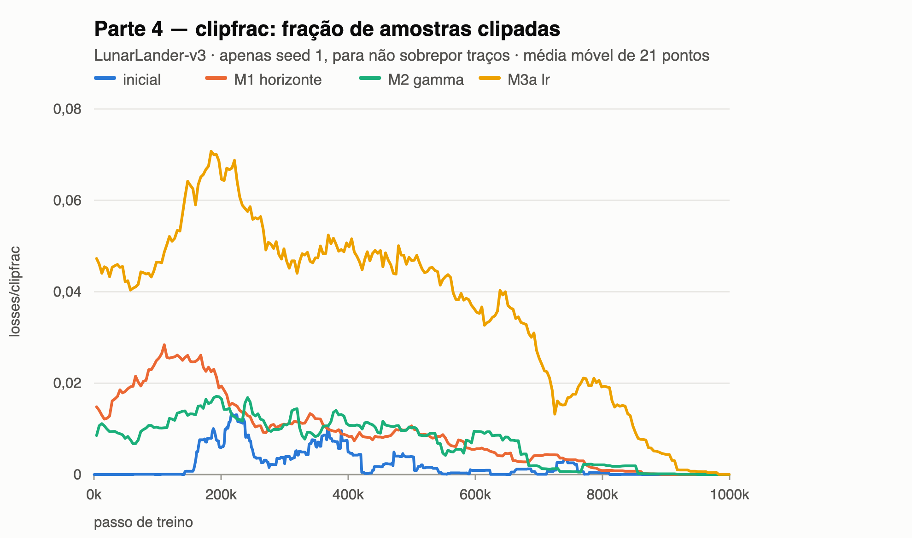

**M1 — `num_steps` 128 → 1024.** O lote de 512 transições cobria **1,16 episódio** em média: cada
atualização via aproximadamente um pouso, e se aquele lote calhasse de conter uma queda, duas ou
nenhuma, a escala das recompensas mudava junto. O `advantage_std` mostra isso direto — 9,8 ± 6,2,
variando de 0,9 a 26 — e a variância explicada mostra de outro jeito: o **nível** quase não muda
(0,57/0,50 contra 0,48/0,59, medidos depois dos 300k passos iniciais), mas a **oscilação** cai
pela metade, de 0,29 para 0,16 de desvio-padrão. Com 1024 passos o lote passa a cobrir 10,5
episódios e o `advantage_std` vai a 14,9 ± 1,8: a mistura é parecida em toda atualização. De
quebra, o peso que a vantagem põe no bootstrap `V(s_T)` da borda do rollout cai de 13% para 4,7%.
O retorno foi de 2,7/12,2 para **72/96**.

O `num_minibatches` subiu de 4 para 32 no mesmo run de propósito. O lote passa de 512 para 4096 e,
sem compensar, o minibatch saltaria de 128 para 1024 e os passos de gradiente cairiam para ~3.900.
Com os dois juntos a contagem fica idêntica (31.232) e a única coisa que muda é o horizonte do GAE.

**M2 — `gamma` 0,99 → 0,999 e `gae_lambda` 0,95 → 0,98.** Com episódios de ~500 passos, o bônus de
+100 por pousar vale `0,99^500 ≈ 0,007` visto do início do episódio: o desconto apagava
exatamente o objetivo da tarefa. O retorno foi para **109/132** e a variância explicada
subiu de 0,50 para **0,75** de média — o ganho de nível que o M1 não tinha dado. Mas o comprimento do episódio **subiu** para 878–941:
o agente passou a pairar ainda melhor. Ou seja, `gamma` consertou o crítico sem resolver o
comportamento — a confirmação de que o problema restante era outro.

**M3 — `learning_rate` 2,5e-4 → 1e-3.** Depois de M1 e M2 o `approx_kl` ainda era 0,003 e o
`clipfrac` 0,005: cada rollout era usado 4 vezes e mal mexia na política, com o mecanismo central
do PPO inerte. Os dois gráficos mostram o efeito — a curva amarela sobe para ~0,007 de `approx_kl`
e ~0,05 de `clipfrac`, uma ordem de grandeza acima do config inicial, ainda assim bem abaixo do
`target_kl` usual de 0,015. O retorno foi para **218/116**: a seed 1 cruzou o critério, a 2 não.

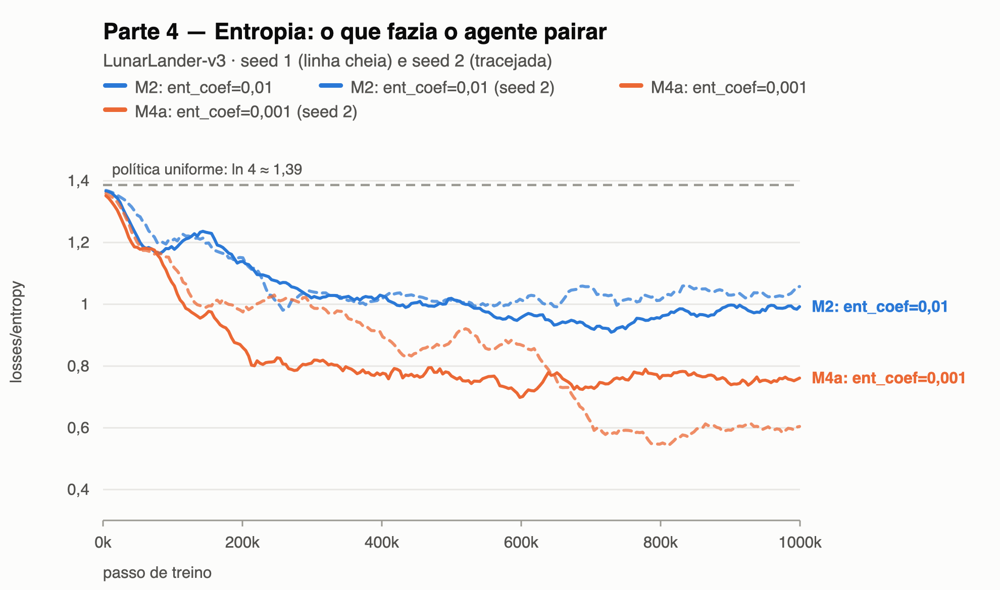 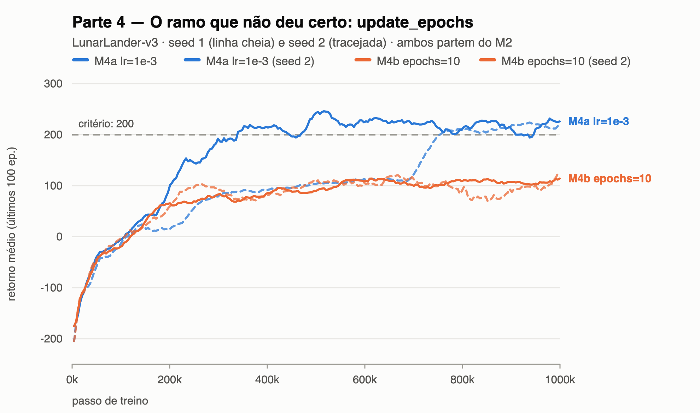

**M4 — `ent_coef` 0,01 → 0,001.** Comparando as seeds que chegaram a 200 com as que travaram em
~115, o padrão é o mesmo nas duas famílias: quem resolveu teve a entropia caindo para 0,69–0,73 e
o comprimento do episódio desabando de ~970 para ~400; quem não resolveu manteve entropia ≥ 0,93 e
episódios de ~925. O bônus de entropia estava pagando o agente para permanecer indeciso — e pousar
exige comprometimento. O gráfico de entropia mostra as duas famílias separadas por ~0,25 nat
durante todo o treino. O retorno foi para **226/218**, com avaliação **219 ± 23 e 210 ± 51**: as
duas seeds passam nos dois critérios, com 1M dos 2M passos permitidos.

**O ramo que não deu certo.** `approx_kl` baixo admite duas leituras: o passo é pequeno demais, ou
o rollout é usado poucas vezes. Testei as duas em paralelo, e `update_epochs` 4 → 10 (M3b, depois
M4b) é a que falhou: ficou em 125/191 e, com `ent_coef` menor junto, **piorou** para 114/119,
contra 226/218 do ramo da learning rate. O custo foi real — 78.080 passos de gradiente contra
31.232, e 1,4× mais tempo de relógio — para um resultado pior. A explicação está no `clipfrac`:
com 10 épocas, as últimas rodam sobre dados que a política já abandonou, e o clipping passa a
descartar justamente o gradiente dessas amostras. Reusar mais não é o mesmo que aprender mais.

**Uma ressalva sobre a métrica de avaliação.** O run `ppo_lunarlander_final` reproduz o `ppo_ll_m4a`
bit a bit no treino (225,1 e 214,7 nas duas seeds, mesmas 31.232 atualizações), mas a avaliação
final deu 219/210 num e 212/231 no outro. São **políticas idênticas**: a diferença de até 20 pontos
é ruído dos 10 episódios amostrados na avaliação, não diferença de agente. Nenhuma conclusão deste
relatório se apoia numa distância menor que essa.

## Parte 5 — PPO contra o A2C

O A2C é o `algorithms/a2c.py` da atividade anterior, partindo de `configs/a2c_cartpole.yml` com
`env_id=LunarLander-v3` e o mesmo orçamento de 1M passos. Tentei ajustá-lo duas vezes e as duas
pioraram (terceira figura), então a comparação usa o config sem ajuste, que foi o melhor dos três.
Os quatro runs desta seção foram medidos **um de cada vez, com a máquina ociosa**: os tempos da
Parte 4, rodada 4 processos em paralelo, variavam 20% entre seeds de configuração idêntica e não
serviriam para comparar relógio.

| | retorno 0 | retorno 100 | retorno 200 | tempo até 200 | retorno final | avaliação |
|---|---|---|---|---|---|---|
| PPO seed 1 | 111k | 201k | **340k** | **51 s** | 225 | 244 |
| PPO seed 2 | 111k | 467k | **754k** | **145 s** | 215 | 214 |
| A2C seed 1 | 214k | 744k | nunca | — | 177 | 197 |
| A2C seed 2 | 138k | nunca | nunca | — | −117 | −111 |

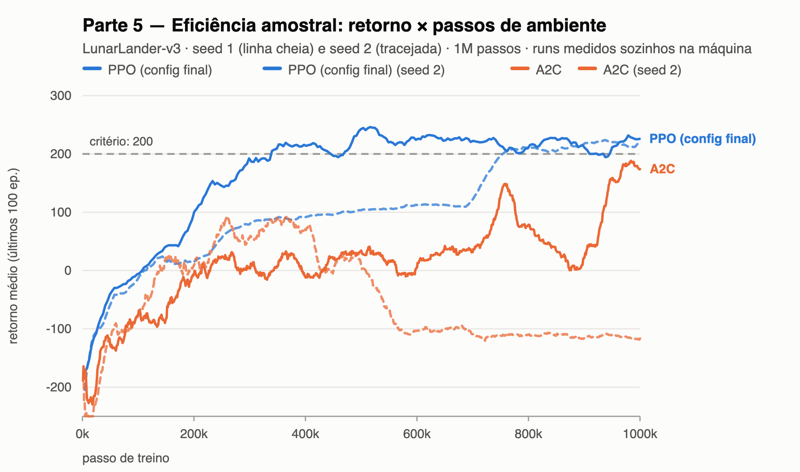 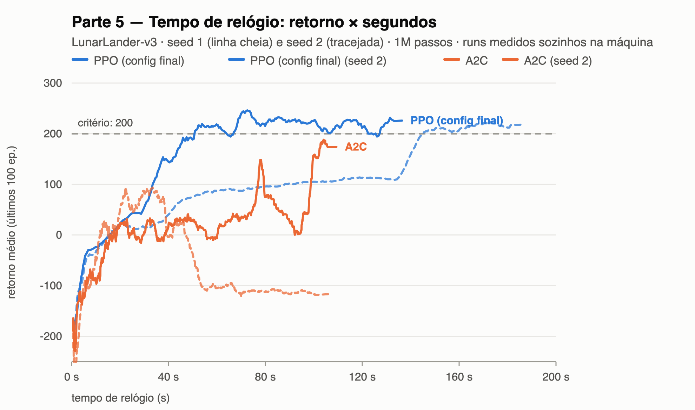 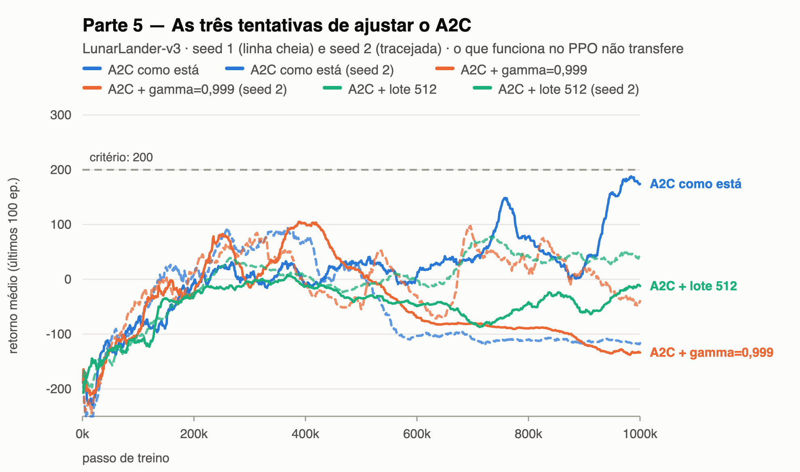

**Eficiência amostral.** No primeiro gráfico as duas curvas saem juntas e se separam por volta de
150k passos: a azul cheia dispara para 200 enquanto as laranjas ficam presas entre −10 e +40 por
mais meio milhão de passos. Até o retorno 0 a diferença é modesta (111k contra 138k e 214k); é
depois dele que ela abre, porque sair de "não cair" para "pousar" é a parte difícil da tarefa, e é
onde o A2C para. Com o mesmo 1M de passos, o PPO termina em 225/215 e o A2C em 177/−117.

**Tempo de relógio.** O PPO é mais lento por passo de ambiente: **136 s contra 109 s** no par mais
limpo (seed 1 de cada), 1,26×. A conta está em `charts/num_updates`: o PPO faz 31.232 passos de
gradiente sobre minibatches de 128, isto é **4,0M de amostras** processadas no backward; o A2C faz
25.000 sobre lotes de 40, **1,0M**. O fator é exatamente `update_epochs = 4` — cada passo de
ambiente entra em quatro gradientes. O que surpreende é o quanto isso *não* custa: quatro vezes o
trabalho de gradiente por 1,26× de relógio, porque quem domina o tempo é simular o ambiente e
coletar o rollout, não a atualização.

**Mesmo orçamento.** Com os mesmos passos o PPO chega muito mais longe, e **a resposta não muda se
o orçamento for o mesmo tempo**: no segundo gráfico o PPO cruza 200 aos 51 s (seed 1) e 145 s
(seed 2), enquanto o A2C, em 109 s de treino inteiro, chega no máximo a 190 e só numa seed. A
vantagem amostral paga o custo por passo com folga.

**Estabilidade.** É onde a diferença é maior. As duas seeds do PPO terminam a 225 e 215, dez pontos
de distância; as do A2C, a 177 e −117 — **294 pontos**, com a seed 2 despencando por volta de 450k
e nunca se recuperando. E a seed 1 do A2C também não é estável: cai de 150 para 0 entre 760k e
890k antes de subir para 190. Depois de cruzar o critério, o PPO oscila dentro de uma faixa de
~30 pontos.

**Mecanismo.** Cada diferença acima sai de uma das quatro mudanças do PPO. O **reuso de amostras**
explica a eficiência amostral, e também por que empurrar o A2C na direção do PPO falhou: subir o
lote do A2C de 40 para 512 (`a2c_ll_tuned`, curva verde) derrubou as atualizações de 25.000 para
1.953, porque sem reuso o lote maior sai direto da contagem de passos de gradiente — no PPO o
mesmo lote é reusado 4 × 32 vezes. O **GAE** explica por que `gamma = 0,999` foi decisivo no PPO e
desastroso no A2C (`a2c_ll_g999`, curva laranja, −134/−40): com λ = 0,98 sobre 1024 passos o PPO
propaga a recompensa do pouso por um horizonte longo, enquanto o retorno de 5 passos do A2C com
γ = 0,999 é quase inteiramente bootstrap de um crítico ruim. A **razão de probabilidades** é o que
torna o reuso legítimo — é ela que mantém o gradiente correto nas épocas 2 a 4, depois que a
política já mudou; o A2C não reusa porque não tem esse corretor. E o **clipping** aparece na
estabilidade: no config final o `clipfrac` fica em ~0,05, ou seja 5% das amostras têm o gradiente
desligado a cada atualização, o que impede um passo grande demais sobre uma vantagem ruidosa — o
freio que faltou na seed que colapsou do A2C.
