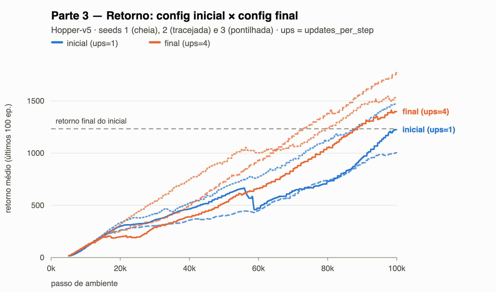
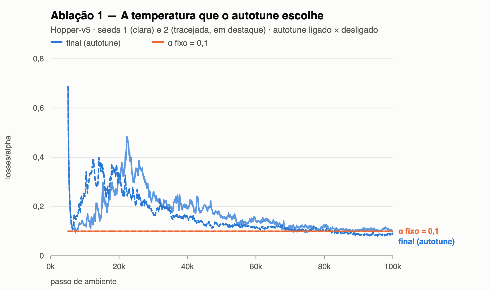
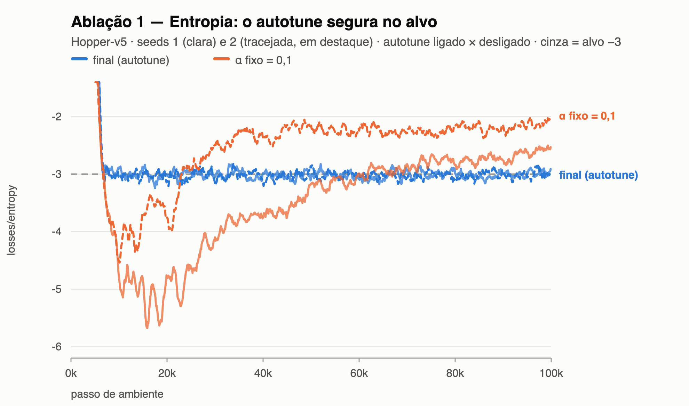
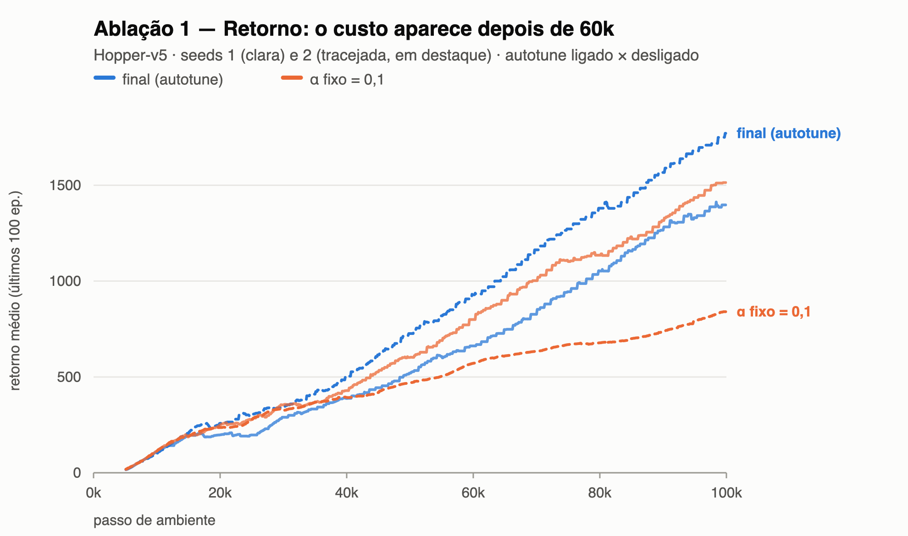
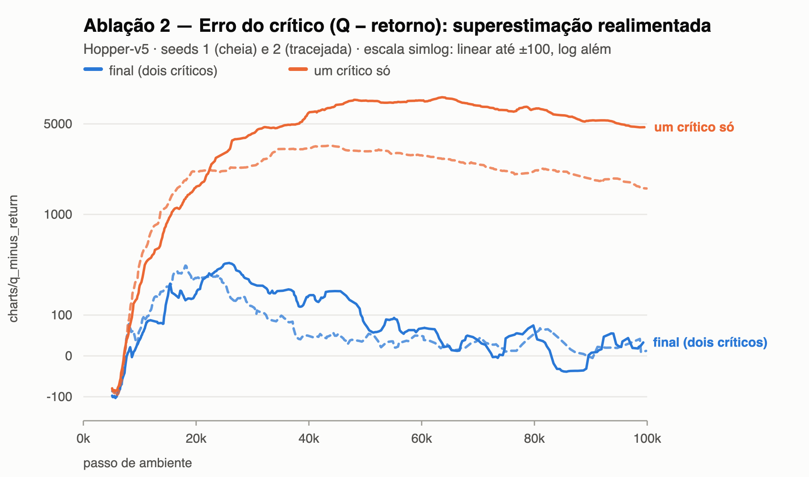
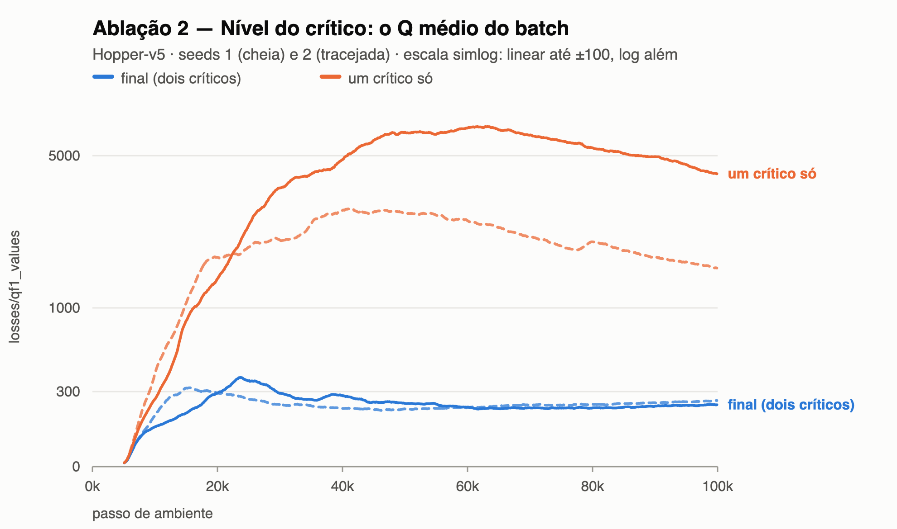
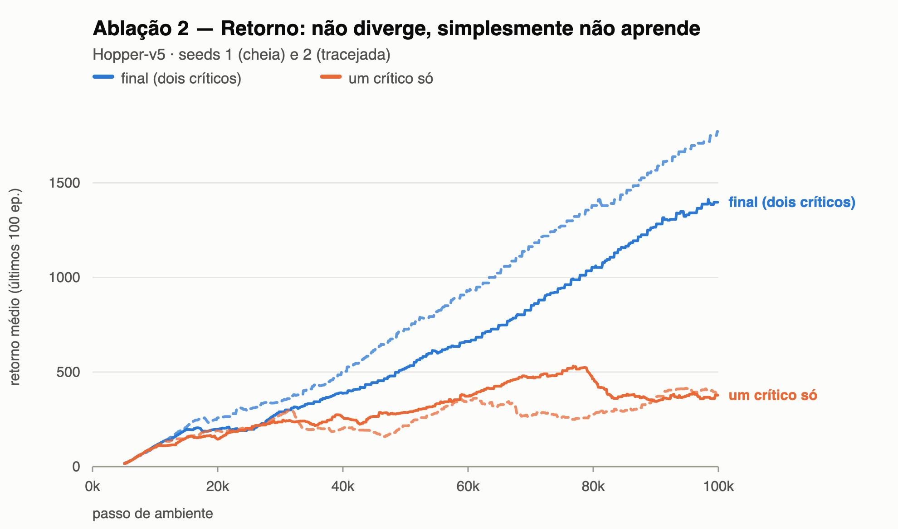
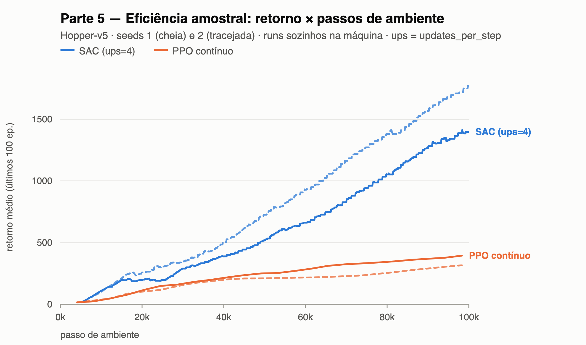
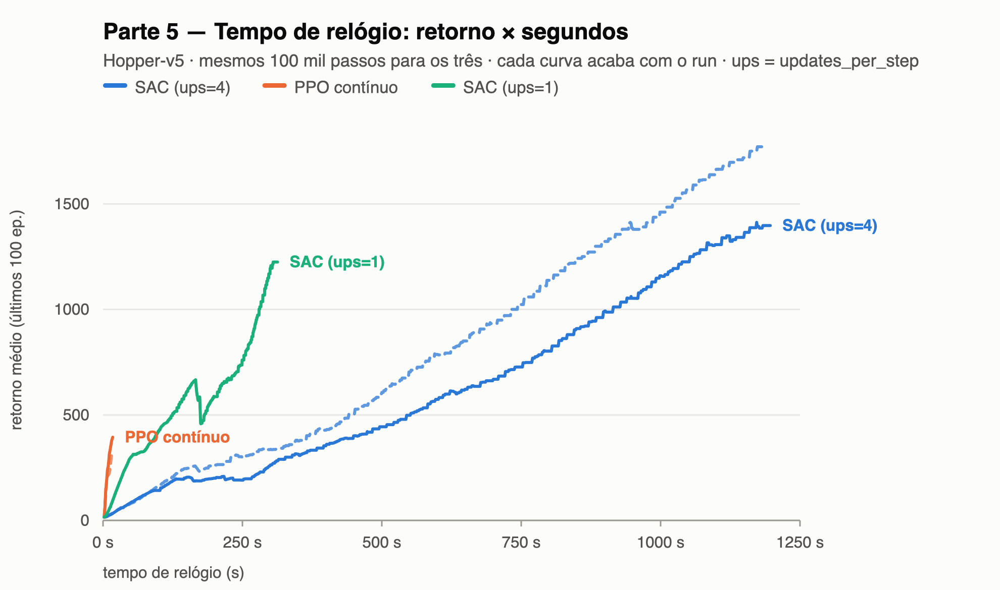

# Soft Actor-Critic (SAC) — Relatório experimental

**Autores:** Frederico Barbosa Relvas · Henrick de Souza Silva · **Fork com `algorithms/sac.py` e
`configs/sac_hopper_final.yml`:** https://github.com/FredRelvas/t-zero-learning · **Projeto no
W&B:** https://wandb.ai/fredrelvas-ceia/sac-assignment

Hopper-v5, orçamento fixo de 100 mil passos de ambiente, 3 seeds por config na Parte 3 e 2 nas
Partes 4 e 5. Cada config vive no W&B sob um `exp_name` próprio (`sac_hopper`, `sac_h_m1`, …,
`sac_h_m4`, `sac_abl_alpha`, `sac_abl_1q`, `sac_final_solo`, `sac_ups1_solo`, `ppo_cont_solo`). O config inicial é
mais forte do que o enunciado sugere — ele chega a 1233 de retorno médio —, mas com uma dispersão
enorme entre seeds: 677 a 2417 de `eval/mean_return`, 3,6× entre o pior e o melhor. É essa
dispersão, e não o retorno, que define a barra de qualquer conclusão aqui.

## Parte 3 — Eficiência amostral

| config | mudança | motivo observado | `eval/mean_return` | `r_last100` | veredito |
|---|---|---|---|---|---|
| `sac_hopper` | — (inicial) | referência | 1598 (677–2417) | 1233 (1004–1470) | — |
| `sac_h_m1` | `updates_per_step` 1 → **2** | no inicial, `qf1_values` termina em 203–236 **ainda subindo** e `q_minus_return` fecha negativo nos 3 seeds: o critic não converge dentro do orçamento | 2035 (402–3527) | **1631 (1320–1874)** | melhora |
| `sac_h_m2` | `batch_size` 256 → **512** | no inicial seed 2, `qf1_loss` termina em 104 contra 12 e 15 das outras — e é a seed de pior avaliação | 1835 (1126–2349) | 1125 (836–1524) | ruído |
| `sac_h_m3` | M1 + M2 juntos | combinar o ganho do M1 com a estabilização que o M2 entregou (`qf1_loss` de 104 para 5,7) | 2478 (1103–3465) | 1199 (945–1490) | ruído |
| `sac_h_m4` | `updates_per_step` 1 → **4** | o M1 funcionou **e** virou o sinal que o motivou (`q_minus_return` de −10 para ≈ 0): empurrar a mesma alavanca | **2619 (1470–3287)** | 1570 (1398–1771) | melhora — **final** |

A figura mostra o que a tabela esconde: as faixas se sobrepõem. Pelo critério estrito do
enunciado — a diferença tem que ser maior que a variação entre seeds — **nenhum candidato é
disjunto do inicial no retorno final**, e dizer isso é uma conclusão válida. O que *é* disjunto
aparece quando se pergunta **quantos passos** cada config leva para atingir 1233, o retorno que o
inicial só alcança no fim: o inicial chega lá em **1 de 3 seeds** (88k), enquanto o M1 chega em
**3 de 3** (72k, 81k, 69k — todas mais rápidas que a única seed bem-sucedida do inicial) e o M4
também em 3 de 3 (73k, 80k, 89k). Em 80 mil passos o piso do M1 (1194) supera o teto do inicial
(1117). A melhora é de eficiência amostral, ~20% menos passos, não de retorno final.

O mecanismo confirma a hipótese: o `q_minus_return` mediano segue exatamente os passos de
gradiente por passo de ambiente — M2 −19 (1 passo), inicial −10 (1), M1 +5 (2), M4 +18 (4).
Treinar mais o critic no mesmo orçamento o tira da subestimação. (Mediana porque o M1 tem um seed
em +98, o mesmo de `eval` 402.)

O M2 prova a tese pelo avesso: **eliminou** o pico de loss que o motivou (104 para 5,7) sem mover
o sinal nem o retorno — o que limita não é a qualidade de cada atualização, é o número delas.

Pela regra do enunciado (melhor média) o final é o **M4**: melhor média de avaliação e melhor
piso, 1470 contra 677 do inicial e 402 do M1. No `r_last100` ele empata com o M1 dentro do ruído,
e o M1 custa metade do relógio; o desempate veio da avaliação.

## Parte 4 — O que cada peça faz

### Ablação 1 — `autotune=false`, `alpha=0,1`

**Previsão (escrita antes de rodar):** fixei 0,1 por ser a mediana do `losses/alpha` na segunda
metade dos runs do config final (0,078 a 0,115 entre seeds) — é onde o ajuste automático *acaba*,
de modo que a ablação isola "fixo × adaptativo" e não "valor errado × valor certo". Esperava
entropia abaixo do alvo de −3 no começo (a curva do α não é plana: ela sobe até ~0,33 em 20 mil
passos antes de decair) e retorno mais baixo até ~40 mil passos, convergindo depois.

  

**O que aconteceu:** acertei o começo e errei o resto. A 10 mil passos a entropia do α fixo está em
−4,87 e −4,97 contra o alvo de −3 — a política fecha cedo demais, como previsto —, mas o retorno
nesse trecho é **igual** ao do config final (251 e 236 a 20 mil passos, dentro da faixa 198–313).
O dano aparece depois de 60 mil passos e pelo motivo oposto. Nas três figuras o rótulo está na
**seed 2 (tracejada)**, porque é só nela que a ablação dói: a entropia **sobe** para −1,81, bem
acima do alvo, e o retorno trava em 841 contra 1771 da seed 2 do config final. Na seed 1 a ablação
termina até acima (1514 contra 1398) — com 2 seeds, o efeito inteiro mora em um deles. A figura da
entropia é a que resume: com autotune ela fica colada em −3 em todos os marcos (−2,76 a −3,19);
sem ele, vagueia nas duas direções. O resultado é 1177 (841–1514) contra 1570 (1398–1771) de
`r_last100`. A linha que explica é `algorithms/sac.py:510`, o bloco `if cfg.autotune:` que deixa de
rodar: sem ele, `self.alpha` fica congelado no valor posto em `sac.py:362` e a restrição de
entropia, que é o objetivo que o SAC de fato otimiza, deixa de ser imposta.

### Ablação 2 — `clipped_double_q=false`

**Previsão:** esta era contraintuitiva de propósito. Com `updates_per_step=4` o `q_minus_return`
do config final **já** é positivo (+16, +32, +16), ou seja os critics já superestimam *com* o
mínimo dos dois. Esperava que o valor subisse para algo entre +50 e +150, que o `qf1_values`
inflasse, e que o retorno piorasse por divergência **tardia** — curvas boas até ~60 mil passos e
depois queda.

  

**O que aconteceu:** direção certa, magnitude errada por duas ordens de grandeza, e o momento
errado. O `q_minus_return` foi a **+4.640 e +1.610** (não +150), o `qf1_values` de ~230 para
**4.200 e 1.560**, o `qf1_loss` de 12 para um pico de **23.000** a 40 mil passos, e a divergência
começa de imediato — já em 20 mil
passos o `q_minus_return` está em +1.740. O que eu não considerei é que sem o `min` a
superestimação é **realimentada**: em `sac.py:476` o target de cada critic é calculado com a
própria rede inflada, então erro vira target vira erro maior, um laço positivo em vez de um viés
limitado. O retorno não "cai": ele nunca sai do lugar, 382 (377–387) contra 1570. E houve um efeito
colateral que eu não previra: o **α explodiu** — 2,78 e 1,06, contra 0,09 do config final —
*enquanto a entropia ficava no alvo* (−2,85 e −2,95). O α é o preço da entropia em unidades de Q,
então ele inflou junto com o Q: 17× de Q para 31× de α numa seed, 6× para 12× na outra. Na
prática, `losses/alpha` funciona como alarme indireto de divergência do critic.

## Parte 5 — SAC contra o PPO contínuo

 

Runs medidos **um de cada vez** na máquina ociosa (`sac_final_solo`, `ppo_cont_solo`).

**Eficiência amostral — o SAC ganha por 4,4×.** A 100 mil passos ele está em 1398 e 1771 de
`r_last100` contra 394 e 316 do PPO, e as faixas nunca se tocam: já a 40 mil passos são 388 e 504
contra 199 e 188. Na avaliação final a distância é maior ainda (3097 e 3302 contra 438 e 340).

**Tempo de relógio — o PPO ganha por 70×.** O SAC levou 1198 s e 1184 s; o PPO, **17 s** nos dois
seeds. O `charts/SPS` diz o mesmo (83–85 contra 6.533–6.764) e o `charts/num_updates` explica:
379.600 contra 7.680. A figura da direita responde a pergunta do enunciado — quem chega mais longe
com o mesmo *tempo*: aos 15 segundos o PPO **já terminou**, em 394, enquanto o SAC está em 29. O
SAC só ultrapassa o resultado final do PPO perto dos 400 s. Ou seja, com os dois limitados aos
mesmos 100 mil passos, abaixo de ~400 s o PPO é a escolha certa no Hopper; acima disso, o SAC. O
que esta medição **não** responde é o PPO sem esse teto: em 1.200 s ele daria ~70× mais passos, e
aí a comparação já não é a do enunciado.

**Mecanismo — o reuso.** A diferença toda cabe numa conta: quantas vezes cada transição entra num
passo de gradiente. No SAC, 379.600 atualizações × batch 256 ÷ 100 mil transições ≈ **970 vezes**
cada uma. No PPO, 7.680 × minibatch 128 ÷ 98.304 transições = **10 vezes**, que é exatamente o
`update_epochs`: sendo on-policy, ele descarta o rollout depois dessas passagens, e o número de
reusos *é* o hiperparâmetro.

**Mecanismo — as quatro peças.** O **replay off-policy** é o que permite esse reuso, e é o que
torna o SAC lento. Os **dois critics** o mantêm estável (sem eles, a Ablação 2 mostra o colapso).
A **entropia máxima** com α ajustado sustenta exploração sem ruído externo. E o **ator
reparametrizado** leva o gradiente de Q à política atravessando a ação, em vez da estimativa por
score function do PPO — é o que torna cada um dos 379.600 passos informativo.

**E o meu `updates_per_step` muda a resposta.** Medi o config inicial (`updates_per_step=1`) sozinho na máquina:
306 s em vez de 1190 s, com reuso de ~240 vezes por transição e `eval/mean_return` 1993. Ele
ultrapassa o resultado final do PPO aos **94 s**, contra 365–450 s do meu config final. Ou seja, a
escolha da Parte 3 quadruplicou o custo de relógio para comprar ~40% de retorno final dentro do
mesmo orçamento de passos — e **inverte** o veredito se a métrica for tempo: por segundo de CPU, o
config inicial domina o final. Vale notar o limite do que medi: em passos de ambiente os dois
cruzam o PPO no mesmo ponto (34k), então subir a razão atualização/dado não compra eficiência
amostral cedo, quando o buffer ainda é pequeno — ela só paga no fim do orçamento.
